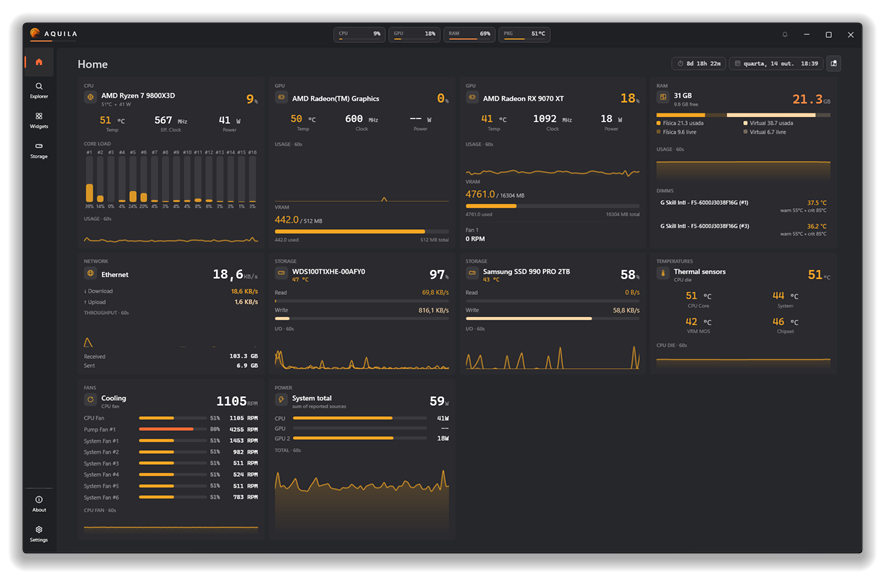
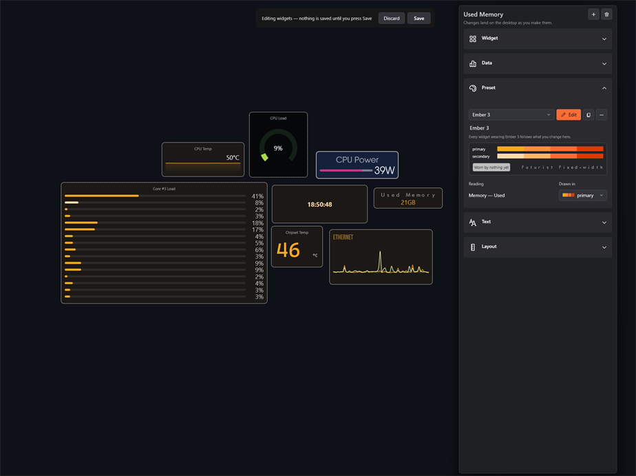
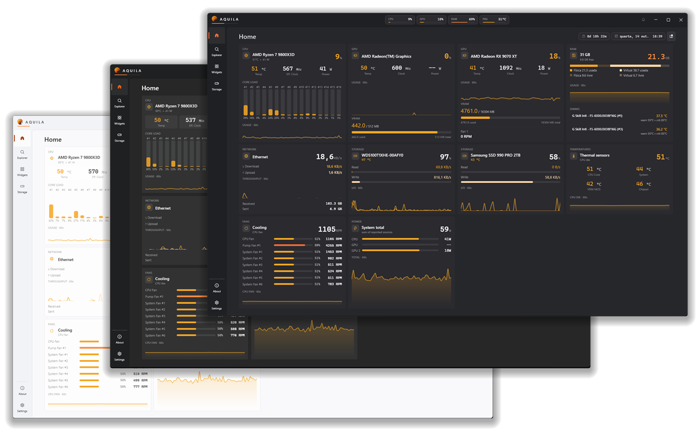
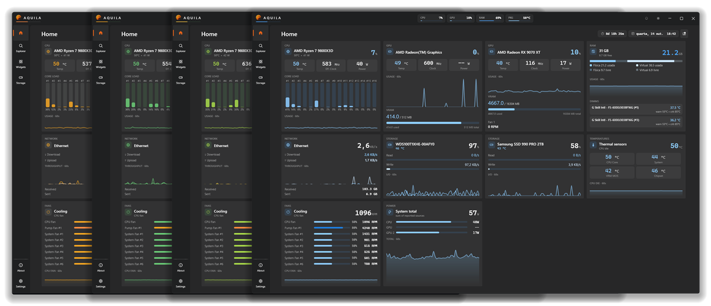
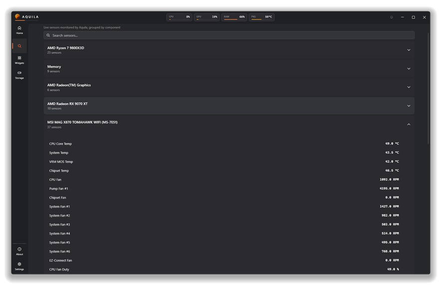
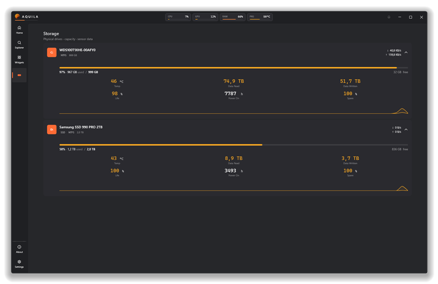

# Aquila

**A free, open-source Windows hardware monitor.**

Real-time CPU, GPU, RAM, network and storage metrics in a clean, responsive dashboard — and on your desktop,
as widgets you design.

 

  

## Download

Grab the latest release from the [**Releases page**](https://github.com/JoaoCrv/Aquila/releases/latest):

- **`Aquila-win-Setup.exe`** — installer with automatic updates (recommended)
- **`Aquila-win-Portable.zip`** — portable build, no installation required

Once installed, Aquila checks for updates silently on startup and notifies you before downloading anything.

Releases are not code-signed, so Windows SmartScreen may warn the first time the installer runs — choose
**More info**, then **Run anyway**. Instead, every release is built by GitHub Actions from a public commit
and carries a signed build attestation, and its notes link a VirusTotal scan. How to check a download is
in [SECURITY.md](SECURITY.md#verifying-a-download).

## Features

- **Desktop widgets** — put any reading on your desktop: dials, sparklines, bars, numbers, an equaliser, text,
  a clock, and backdrops to group them on. They sit above the wallpaper and behind your windows, and clicks
  pass straight through them.
- **Create and edit them in place** — add a widget from the Widgets page, or pin any sensor straight from the
  Explorer. Edit mode keeps the widgets on your real desktop while a docked editor sets each one's kind,
  readings, preset, text and layout; drag them where you want them. Nothing is saved until you press Save,
  and Discard puts everything back.
- **Make it yours** — themes dress the app, presets dress the data: colour ramps, typefaces, dials and bars,
  chosen per widget. Edit the built-in presets, make your own, and share them as files.
- **Tray flyout and menu** — click the tray icon for the machine at a glance: CPU, GPU, RAM and package
  temperature, the latest notice, and shortcuts to open Aquila, edit widgets or exit. Right-click for a menu
  in the app's own theme. Minimize to tray, start with Windows, start minimized.
- **Notices** — a bell in the title bar says what is true now (no administrator rights, a widget that cannot
  draw, an update that could not be installed) and keeps what happened while you were away.
- **Limits you set** — one place decides when a reading turns high or critical. Drives and memory that report
  their own limits are judged by them.
- **Borderless dashboard mode** — a frameless window you can pin to a secondary monitor or TV; opens and closes
  from anywhere, no restart
- **Responsive card grid** — cards reflow as the window resizes; all cards in a row match the tallest
- **Full sensor coverage** — CPU, GPU (multi-GPU), RAM, network, storage, fans, power and motherboard
  temperatures, plus a sensor explorer for raw access to everything

## Screenshots

### Desktop widgets

Edit mode: the widgets stay on the real desktop while the editor docks beside them, and nothing is saved until
you press Save.

### Themes

More than one look for the app itself: **Aquila**, its own dark theme, and **Fluent**, which takes your Windows
accent colour and comes in light and dark — or follows Windows as it switches between them.

### Presets

A preset decides how readings are drawn — the colours a value moves through as it climbs, the typefaces, the
dials and bars. Four come built in: **Ember**, **Classic**, **Signal** and **Sky**. Every one is editable, and the
widgets wearing it change as you edit; a built-in is never overwritten, your changes are kept as a copy of your
own. Start a new preset from any other, and export or import them as files. The dashboard wears
one, and every desktop widget can wear its own.

### Sensors and storage

<table>
  <tr>
    <td width="50%" valign="top">
      <strong>Explore your computer's sensors</strong> — every reading the hardware reports, grouped by component,
      live and searchable. Any of them can go straight to the desktop as a widget.
    </td>
    <td width="50%" valign="top">
      <strong>Analyze your storage</strong> — each drive's capacity, temperature, life left, data read and written
      and hours powered on, with its read and write rates live.
    </td>
  </tr>
  <tr>
    <td width="50%"></td>
    <td width="50%"></td>
  </tr>
</table>

## Demos

**Create and edit widgets**

https://github.com/user-attachments/assets/bfed3dca-ae4f-467d-86fb-4fe7dca73c78

**Dashboard mode**

https://github.com/user-attachments/assets/179b1550-948f-4858-b8a7-1bb120f3f6f6

**Responsive layout**

https://github.com/user-attachments/assets/7bf0c2fa-bf74-4ff3-a063-b06adae9a40c

## Project principles & privacy

- free to use, open source under `MPL-2.0`
- no ads
- no telemetry, analytics, accounts, or personal data collection
- the only network communication is the optional update check and download through `Velopack`, and — only if
  you agree — downloading PawnIO from its official release

## Support

Aquila is not sold as a commercial product by the maintainer. Optional donations may help support future development, but there are no paid features and no advertising in the app.

## Open-source dependencies

Aquila is built with and made possible by several open-source projects:

| Project                                                                              | Purpose                                       | License    |
| ------------------------------------------------------------------------------------ | --------------------------------------------- | ---------- |
| [LibreHardwareMonitor](https://github.com/LibreHardwareMonitor/LibreHardwareMonitor) | hardware sensors and monitoring data          | MPL-2.0    |
| [WPF-UI](https://github.com/lepoco/wpfui)                                            | Fluent-style WPF controls and navigation      | MIT        |
| [WPF-UI.DependencyInjection](https://github.com/lepoco/wpfui)                        | DI integration for WPF-UI                     | MIT        |
| [Velopack](https://github.com/velopack/velopack)                                     | packaging and in-app updates                  | MIT        |
| [CommunityToolkit.Mvvm](https://github.com/CommunityToolkit/dotnet)                  | MVVM helpers, source generators, commands     | MIT        |
| [LiveCharts2](https://github.com/beto-rodriguez/LiveCharts2)                         | charts and sparklines                         | MIT        |
| [Microsoft.Extensions.Hosting](https://github.com/dotnet/runtime)                    | dependency injection and app hosting          | MIT        |
| [Serilog.Extensions.Hosting](https://github.com/serilog/serilog-extensions-hosting)  | logging, wired into the app host              | Apache-2.0 |
| [Serilog.Sinks.File](https://github.com/serilog/serilog-sinks-file)                  | the log files in Documents\Aquila\logs        | Apache-2.0 |
| [TaskScheduler](https://github.com/dahall/TaskScheduler)                             | the task that starts Aquila elevated at logon | MIT        |
| [PawnIO](https://github.com/namazso/PawnIO)                                          | driver for motherboard and memory sensors     | GPL-2.0    |

Those are the packages Aquila asks for directly — except PawnIO, which it does not ship. PawnIO is a signed
kernel driver that LibreHardwareMonitor reads fans, the motherboard and the memory through. Aquila installs it
only if you agree: on first run, downloaded from its official release, after checking its signature.
Uninstalling Aquila leaves it in place, since other hardware tools use it too.

Every package Aquila ships — they bring others with them — is listed with its licence and copyright in
[THIRD-PARTY-NOTICES.txt](THIRD-PARTY-NOTICES.txt), which is also installed with the app
(**About → Third-party licences**).

## Maintainer

- [@JoaoCrv](https://github.com/JoaoCrv)

## Development

Aquila is built and maintained by [@JoaoCrv](https://github.com/JoaoCrv), with parts of the development assisted by AI tooling.

## License

This project is licensed under the terms of the **Mozilla Public License 2.0 (MPL-2.0)**.

You can find the full text in the `LICENSE` file at the root of this repository, or read it online at https://www.mozilla.org/MPL/2.0/.
